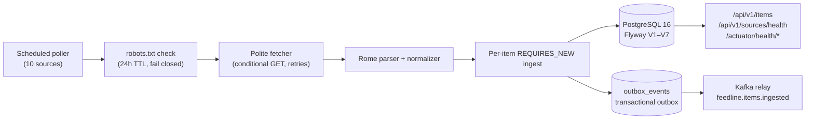

# Feedline — Scheduled Feed Ingestion Service

**A small, complete Spring Boot + PostgreSQL service: a scheduled poller that fetches ten RSS/Atom feeds, normalizes them, and stores items idempotently.**

> Feedline is a skills showcase built to production standards: schema migrations from the first commit, integration tests against a real database, enforced static analysis in the build, and a standing rule that a test which cannot pass honestly is reported — never weakened until it does.

---

## Project at a glance

| | |
|---|---|
| **Service type** | Single-process scheduled feed ingestion (RSS/Atom) |
| **Stack** | Java 21 · Spring Boot 3.3.5 (`web`, `actuator`, `data-jpa`) · PostgreSQL 16 · Flyway (V1–V6) · Rome · Maven |
| **Ingestion model** | One fixed-delay poll cycle over 10 enabled feeds (news, markets, and central-bank press releases), with per-host politeness, conditional GET, bounded redirects, retries, timeouts, and body caps |
| **Persistence** | `feed_sources` registry + `items` table; unique `(source_id, guid)` makes ingestion insert-if-absent. Per-item skips are recorded in `ingest_skips` |
| **Fetch policy** | `robots.txt` consulted per origin and cached for 24 hours; fail closed on 403, 5xx, and network/timeout errors; 404 means no rules (allow) |
| **API** | `/api/v1/items` with keyset pagination and full-text search, `/api/v1/sources/health`, Actuator health/liveness/readiness probes, OpenAPI docs |
| **Testing** | JUnit unit + MockWebServer wire tests + Testcontainers integration tests against real PostgreSQL |
| **Static analysis** | SpotBugs runs at `verify` with `failOnError=true` |

## How to read this repository

- **README.md** (this file) — what the service is, how it runs, and how it is tested.
- **[REPORT-M2B-HARDENING.md](REPORT-M2B-HARDENING.md)** — latest hardening report: ingest isolation, health split, and ingest proof.
- **[DECISIONS.md](DECISIONS.md)** — the design-decision log: choices made, alternatives considered, and why.
- **[HANDOFF.md](HANDOFF.md)** — current working notes.

---

## What it does

A poll cycle walks the ten feeds configured in `application.yml` (BBC, The Verge, Yahoo, MarketWatch, Bloomberg, Investing.com, FXStreet, Federal Reserve, Bank of Canada, CNBC). For each source it:

1. checks `robots.txt` for the origin and enforces the per-host request interval;
2. fetches with conditional GET (`If-None-Match` / `If-Modified-Since`), bounded redirects, timeouts, and retries;
3. short-circuits on `304 Not Modified`, otherwise parses with Rome and normalizes each entry into an `Item`;
4. ingests each item in its own `REQUIRES_NEW` transaction, so one bad item cannot roll back the feed;
5. records skipped items and advances the stored validators only after a fully clean `200` poll.

Flyway owns the schema from V1 through V6; the application never creates tables itself.

## Architecture

## Quick start

1. `docker compose up -d` — start PostgreSQL 16, a single-node Kafka broker in KRaft mode, and Feedline; healthchecks gate readiness.
2. Feedline migrates the schema with Flyway, seeds the source registry, starts polling the ten configured feeds, and serves the API on `http://localhost:8080`.
3. `docker compose logs -f feedline` — watch poller and outbox relay output; events land on `feedline.items.ingested`.

No paid services, no cloud, no API keys. Everything is open source.

## API

| Endpoint | Purpose |
|---|---|
| `GET /api/v1/items` | Page of items, newest first; `source`, `q`, `from`, `to`, `cursor`, `size` (max 100). Keyset pagination on `(fetched_at, id)` with a `nextCursor` in the response. |
| `GET /api/v1/items/{id}` | One item, or a RFC 7807 `problem+json` error. |
| `GET /api/v1/sources/health` | Per-source fetch state and last successful poll; mirrors readiness status. |
| `GET /actuator/health/readiness` | Readiness probe (`readinessState`, `db`, `pollCycleHeartbeat`). |
| `GET /actuator/health/liveness` | Liveness probe (`livenessState`). |
| `/swagger-ui.html`, `/v3/api-docs` | OpenAPI documentation. |

Unknown query parameters, malformed cursors, and bad ranges return `400 application/problem+json`.

## Transactional bookmark invariant

ETag and Last-Modified are **bookmarks into the remote feed**. They advance only when an entire `200` poll ingests cleanly. If any item is skipped, the skip is recorded and the old bookmark is kept, so the next poll re-fetches the same feed version instead of permanently hiding the skipped item. A `304` never advances a bookmark either. Each item is written in its own `REQUIRES_NEW` transaction so a single malformed item cannot roll back its siblings.

## Tests and CI

- `mvn clean verify` — the full local gate: unit tests, MockWebServer wire tests, Testcontainers PostgreSQL integration tests, plus SpotBugs with `failOnError=true`.
- GitHub Actions runs `mvn verify` on pushes to `main` and on pull requests, but the free-tier minutes are exhausted until **December 1**; until they reset on the **1st of the month**, `mvn clean verify` locally is the verification gate.
- A test that cannot pass honestly is reported, never weakened just to make the suite green.

## About this build

Feedline was produced by an operator directing coding agents: source, tests, and documentation were written by agents and verified against the test suite and the milestone reports. It is a learning showcase, deliberately small — the point is the engineering discipline around it, not the size of the service.

## License

See [LICENSE](LICENSE). Published for review and portfolio purposes; all rights reserved.
