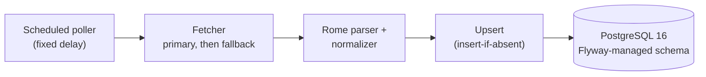

# Feedline — Scheduled Feed Ingestion Service

**A small, complete Spring Boot + PostgreSQL service: a scheduled poller that fetches RSS/Atom feeds, normalizes them, and stores items idempotently.**

> Feedline is a skills showcase built to production standards: schema migrations from the first commit, integration tests against a real database, static analysis in the build, and a standing rule that a test which cannot pass honestly is reported — never weakened until it does.

---

## Project at a glance

| | |
|---|---|
| **Service type** | Single-process scheduled feed ingestion (RSS/Atom) |
| **Stack** | Java 21 · Spring Boot 3 (`web`, `data-jpa`) · PostgreSQL 16 · Flyway · Rome (feed parsing) · Maven |
| **Ingestion model** | Fixed-delay scheduled poller; primary feed with a fallback feed used only when the primary does not return valid RSS |
| **Persistence** | `feed_sources` registry + `items` table; a unique `(source_id, guid)` constraint makes ingestion insert-if-absent (idempotent re-polls) |
| **Testing** | JUnit unit tests (normalizer, against a captured real feed) + Testcontainers integration tests against real PostgreSQL |
| **Static analysis** | SpotBugs wired into the Maven build |
| **Status** | Milestone 1 complete — poller, persistence, migrations, and tests in place; further milestones in progress |

## How to read this repository

- **README.md** (this file) — what the service is, how it runs, and how it is tested.
- **[REPORT-M1.md](REPORT-M1.md)** — the Milestone 1 build record: what was built and how each piece was verified.
- **[DECISIONS.md](DECISIONS.md)** — the design-decision log: choices made, alternatives considered, and why.
- **[HANDOFF.md](HANDOFF.md)** — current working notes for the milestone in progress.

---

## What it does

Feedline polls one configured feed on a fixed delay, parses it with Rome, normalizes each entry into an `Item` entity, and upserts the items into PostgreSQL. Re-polling the same feed is safe: the unique `(source_id, guid)` constraint turns storage into insert-if-absent, so duplicates never accumulate. If the primary feed does not return valid RSS, the fetcher falls back to a secondary feed. On first run the poller also seeds the `feed_sources` registry row, so the database starts from an empty, migrated schema.

The feed and cadence are configured in `application.yml`:

- primary: `https://www.cbc.ca/webfeed/rss/rss-topstories`
- fallback: `https://feeds.bbci.co.uk/news/world/rss.xml`
- cadence: `feed.poll-delay` (default 60 s)

## Architecture

One process, no external services beyond the database: the scheduler drives the fetcher, the fetcher's output is normalized into entities, and persistence is a single upsert path guarded by the uniqueness constraint. Flyway owns the schema from the first migration onward — the application never creates tables itself.

## Quick start

1. `docker compose up -d` — start PostgreSQL (compose file `docker-compose.yml`, image `postgres:16-alpine`); a healthcheck gates readiness.
2. `mvn spring-boot:run` — start Feedline. Flyway migrates the schema on first start and the poller begins pulling the configured feed.
3. `docker compose logs -f` — watch the poller output.

No paid services, no cloud, no API keys. Everything is open source.

## Tests

- **Unit tests** — `mvn test` — the normalizer is fed a captured real feed XML (under `src/test/resources/fixtures/`) plus a synthetic entry without a guid.
- **Integration tests** — `mvn verify` — Testcontainers-backed PostgreSQL tests: save + read-back, and an insert-if-absent assertion against the real constraint. The single `mvn verify` command runs the whole suite.

## About this build

Feedline was produced by an operator directing coding agents: source, tests, and documentation were written by agents and verified against the test suite and the milestone report (see [REPORT-M1.md](REPORT-M1.md)). It is a learning showcase, deliberately small — the point is the engineering discipline around it, not the size of the service.

## License

See [LICENSE](LICENSE). Published for review and portfolio purposes; all rights reserved.
