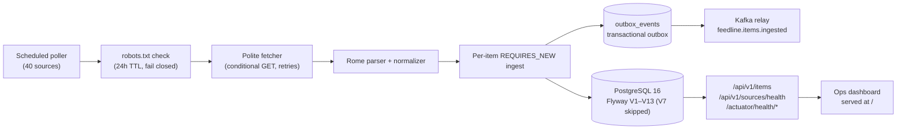
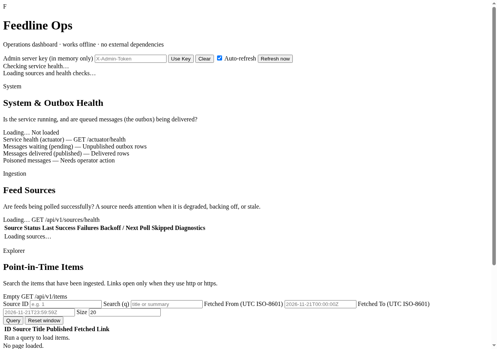

# Feedline — Scheduled Feed Ingestion Service

[](https://github.com/kopekijay11-hub/feedline/actions)


Feedline is a small, complete Java/Spring Boot content-ingestion service: a scheduled poller fetches 40 RSS/Atom sources, normalizes and deduplicates the entries, stores them in PostgreSQL, exposes them through a REST API, and publishes each new item to Kafka through a transactional outbox. A browser-based operations dashboard sits on top of the same REST surface, alongside a reader front end: a category explorer, per-feed subscribe popovers, clustered top stories, and merged per-category RSS feeds for external readers. It is built to production standards — schema migrations from the first commit, integration tests against a real database and Kafka, and enforced static analysis in the build — and is intended as a learning/showcase project rather than a hosted product.

---

## What this is

Scheduled RSS/Atom ingestion, dedupe, PostgreSQL, REST API, Kafka via transactional outbox, ops dashboard. Feedline polls a curated set of news, markets, and central-bank press-release feeds on a fixed delay, applies per-host politeness, conditional GET, redirects, retries, timeouts, and body caps, normalizes each entry into an `Item`, and stores it idempotently on `(source_id, guid)`. Items without a feed-provided GUID receive a synthetic GUID: SHA-256 of link/title/published_at; collision resistance is assumed (audit B-07, accepted/open). Items are queryable through `/api/v1/items` with keyset pagination and full-text search. Every newly stored item also lands in an `outbox_events` table and is relayed to the Kafka topic `feedline.items.ingested` by a separate relay, so the database write and the message publication stay consistent. A single-process service with no paid services, no cloud, and no API keys required to run it.

Who it is for: developers learning or demonstrating Spring Boot, JPA, Flyway, Kafka, and Testcontainers. What problem it solves: turning a set of public feeds into a queryable, deduplicated, event-emitting content store with an honest operations dashboard, end to end, in one runnable container stack.

## Status

Complete and running live. Milestones M1–M3 are built and merged, and the reader dashboard (category explorer, subscribe popovers, top stories) landed after them. A full-system audit was performed and its findings were either fixed or converted into permanent tests (outbox invariant by fault injection, pagination boundaries, gzip bomb bound, admin route enumeration). The test suite count below is as proven at this branch's `mvn clean verify`, and SpotBugs is enforced in the verify gate with `failOnError=true`.

## Architecture

Poll -> parse -> normalize/dedupe -> PostgreSQL -> REST API. Separately, outbox table -> relay -> Kafka. The dashboard reads the same REST surface.



Delivery is at-least-once: the relay publishes then marks the row published, so a crash between the Kafka ack and the state update can cause a duplicate on the next relay pass; consumers must dedupe on the event key.

## Messaging

Items are published to the Kafka topic `feedline.items.ingested` by the transactional outbox relay. Producer posture, as configured in `src/main/resources/application.yml`:

- idempotence: on (`enable.idempotence: true`)
- acks: all
- `max.in.flight.requests.per.connection`: not set in `application.yml` — Kafka default 5 (idempotence permits at most 5 while preserving per-partition order)

The honest ordering claim: ordering is per-partition only. Events sharing a key (`sourceId:guid`) keep their order; no global ordering across the topic is claimed.

## Install and setup (quickstart)

Prerequisites: Java 21, Maven 3.9+, Docker with the Compose plugin (v2), git, and free ports 8080, 5432, 9092.

1. Clone:

   ```bash
   git clone https://github.com/kopekijay11-hub/feedline.git
   cd feedline
   ```

2. Start the whole stack (PostgreSQL 16, single-node Kafka in KRaft mode, and Feedline; healthchecks gate readiness):

   ```bash
   docker compose up -d --build
   ```

3. How to know it worked — health endpoint:

   ```bash
   curl -s http://localhost:8080/actuator/health
   ```

   Expected output: `{"status":"UP"}` (or `{"status":"UP","groups":["liveness","readiness"]}` depending on detail). Readiness includes the database and the poll-cycle heartbeat:

   ```bash
   curl -s http://localhost:8080/actuator/health/readiness
   ```

4. Dashboard reachable at the served root path:

   ```bash
   curl -s -o /dev/null -w "%{http_code}\n" http://localhost:8080/
   ```

   Expected: `200`. Open `http://localhost:8080/` in a browser.

5. First items visible (the poller runs on a 60 s cycle, so allow up to ~90 s):

   ```bash
   curl -s "http://localhost:8080/api/v1/items?size=5" | head -c 300
   ```

   Expected: a JSON object with a `content` array of items.

6. Stop:

   ```bash
   docker compose down
   ```

   To also remove the persisted database volume: `docker compose down -v`.

No paid services, no cloud, no API keys. Everything is open source.

## The dashboard

The dashboard is the static page served at the root path `http://localhost:8080/` (Spring Boot welcome page → `static/index.html`), with no external dependencies and no build step.

Reader surfaces on the same page:

- Explorer: browse ingested items by category chip (World, Trading, Canada, and more), over a 7-day window at 50 items per page.
- Subscribe: clicking a feed name opens a popover with its RSS link (copy or open in an external reader) and a preview of its latest items — nothing downloads.
- Top Stories: the newest clustered stories, ranked by recency rather than cluster size.

What each operations panel shows, in plain language:

- Overall health banner (top): "All sources healthy", "N of M sources need attention", "Service unreachable", "No sources registered", or "Polling heartbeat is stale".
- System & Outbox Health: is the service running, and are queued messages (the outbox) being delivered — pending, published, and poisoned counts.
- Feed Sources: are feeds being polled successfully; a source needs attention when degraded, backing off, or stale.
- Point-in-Time Items: search the ingested items by source, text, and fetched-at window; links open only when they use http or https.
- Outbox Controls: manual repair tools for poisoned messages (list, replay one, replay batch, cleanup).

Embedded screenshot from the repository:



Admin section: admin actions (outbox replay/cleanup) need `FEED_ADMIN_API_KEY` set on the server. Without it the admin API is closed by design and those calls return `401`. Public endpoints and ingestion are unaffected.

## Configuration

Key environment variables:

| Variable | Purpose |
|---|---|
| `SPRING_DATASOURCE_URL` / `SPRING_DATASOURCE_USERNAME` / `SPRING_DATASOURCE_PASSWORD` | PostgreSQL connection |
| `KAFKA_BOOTSTRAP_SERVERS` (or `SPRING_KAFKA_BOOTSTRAP_SERVERS`) | Kafka bootstrap servers |
| `FEED_ADMIN_API_KEY` | Admin API token for `/api/v1/admin/**` (required; closed by design when unset/blank) |
| `FEED_POLLER_WORKER_ID` | Stable poller worker identity for leases/diagnostics |
| `DB_POOL_MAX_SIZE`, `DB_POOL_MIN_IDLE` | HikariCP pool sizing |
| `FEED_ITEMS_DEFAULT_PAGE_SIZE`, `FEED_ITEMS_MAX_PAGE_SIZE`, `FEED_ITEMS_SEARCH_LANGUAGE` | Items query defaults/caps |
| `JAVA_TOOL_OPTIONS` | JVM flags (e.g. `-Xmx768m`) |

The 40 configured sources are listed in `src/main/resources/application.yml` — world and national news, markets and trading wires, technology, company news, and central-bank and official releases (the original seed set included BBC News World, The Verge, Bloomberg Markets, the Federal Reserve, and the Bank of Canada). Sources that were considered and refused are documented in [docs/rejected-sources.md](docs/rejected-sources.md).

## Subscribe

Feedline republishes merged RSS 2.0 feeds, one per category plus an all-items feed:

- `/feed/all.xml`
- `/feed/world.xml`
- `/feed/trading.xml`
- `/feed/canada.xml`
- `/feed/united-states.xml`
- `/feed/europe.xml`
- `/feed/asia-pacific.xml`
- `/feed/technology.xml`
- `/feed/official-releases.xml`
- `/feed/company-news.xml`

Import every subscription at once with `/feed/index.opml`.

## Development

```bash
mvn clean verify
```

The full local gate: JDK `HttpServer`/MockWebServer wire tests, Testcontainers PostgreSQL and Kafka integration tests (all under Surefire), plus SpotBugs with `failOnError=true`. Current baseline at this branch: 248 tests, 0 failures/errors/skips, 0 SpotBugs findings (verified on the merged tip, 2026-11-26).

Tests a reader should know exist:

- Outbox invariant by fault injection (`OutboxInvariantTest`): real Postgres + real Kafka across DB failure mid-ingest, broker down at relay time, and relay killed between Kafka ack and mark-published; asserts DB items equal distinct consumed event keys.
- Docker-free smoke slice (`DockerFreeSmokeSliceTest`): context boots with no Docker available, actuator health returns 200, `FeedPollerService` bean present.
- Route enumeration (`AdminRouteEnumerationTest`): every `/api/v1/admin/**` route × (no token, wrong token, burned default token) → 401, including path variants.

## Decisions

Design decisions, alternatives considered, and rationale: [DECISIONS.md](DECISIONS.md). The full-system audit and its completion report: [REPORT-AUDIT-COMPLETION.md](REPORT-AUDIT-COMPLETION.md). Further milestone reports are in the repository root (`REPORT-*.md`).

## API

| Endpoint | Purpose |
|---|---|
| `GET /api/v1/items` | Page of items, newest first; `source`, `q`, `from`, `to`, `fetchedFrom`, `fetchedTo`, `cursor`, `size` (default/max from `feed.items.*`, defaults 20/100). Keyset pagination on `(fetched_at, id)` with a `nextCursor`. `from`/`to` filter `published_at`; `fetchedFrom`/`fetchedTo` filter `fetched_at`. |
| `GET /api/v1/items/{id}` | One item, or a RFC 7807 `problem+json` error. |
| `GET /api/v1/sources/health` | Per-source fetch state, backoff/error state, and last successful poll. |
| `GET /api/v1/admin/outbox/poisoned` | Admin-only: list poisoned outbox rows (`page`, `size`, optional `topic`). Requires `X-Admin-Token`. |
| `POST /api/v1/admin/outbox/poisoned/{id}/replay` | Admin-only: replay one poisoned outbox row. Requires `X-Admin-Token`. |
| `POST /api/v1/admin/outbox/poisoned/replay-batch` | Admin-only: replay oldest poisoned rows (`topic`, `limit`). Requires `X-Admin-Token`. |
| `GET /actuator/health/readiness` | Readiness probe (`readinessState`, `db`, `pollCycleHeartbeat`). |
| `GET /actuator/health/liveness` | Liveness probe (`livenessState`). |
| `/swagger-ui.html`, `/v3/api-docs` | OpenAPI documentation. |

Unknown query parameters, malformed cursors, and bad ranges return `400 application/problem+json`.

## License

See [LICENSE](LICENSE) — MIT License.
