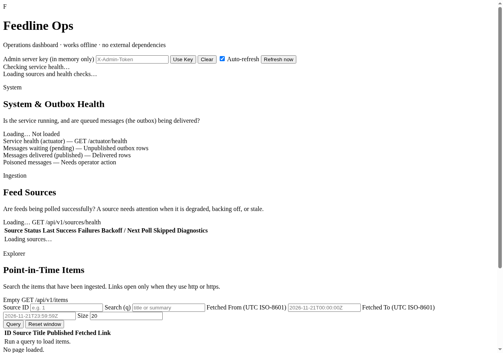

# REPORT-OPS-DASHBOARD-UX

Branch: `ops-dashboard-ux` (off `main` at 8c71e23).

## Step 0 — Survey of the previous page

Panels (before):
- `System & Outbox Health` (`#health-title`): actuator status + pending/published/poison counts; states only via inline error.
- `Feed Sources` (`#sources-title`): table of sources with status, last success, failures, backoff, skipped, diagnostics.
- `Point-in-Time Items` (`#items-title`): filter form + paginated table with item link.
- `Outbox Controls` (`#admin-title`): admin-key-gated poison list + replay/cleanup.

Endpoints used (unchanged): `/actuator/health`, `/api/v1/sources/health`, `/api/v1/items`, `/api/v1/admin/outbox/stats`, `/api/v1/admin/outbox/poisoned`, replay/cleanup. No new endpoints.

States before: loading text only; errors replaced tables with "Failed..." (losing last good data); no stale marker; no empty distinction; admin 401 looked broken.

## Changes

Part 1 — Health first, plain language:
- New top-of-page `#overall-status` banner with plain headline: "All sources healthy", "N of M sources need attention", "Service unreachable", "No sources registered", "Polling heartbeat is stale".
- Plain-language titles retained (`System & Outbox Health`, `Feed Sources`, `Point-in-Time Items`, `Outbox Controls`) plus `panel-help` one-line explanations; technical terms (outbox, poisoned) explained.
- Actionable numbers (pending, poisoned, items) use `.stat-primary` emphasis; diagnostics secondary.

Part 2 — Honest states:
- Each panel has `panel-state` pill: Loading… / Up to date / Empty / Error / Stale, plus `is-*`/`data-state` classes (visibly different).
- Failed refresh keeps last rows and shows `Last updated <time> — refresh failed` marker plus inline error; no stale numbers masquerade as current.
- Admin: 401 produces plain explanation of closed-by-design (`FEED_ADMIN_API_KEY`) vs rejected key. Key remains in-memory only (`state.adminKey`).

Part 3 — Scheme fix:
- Item link renders as anchor only when `new URL(value)` parses with `http:`/`https:` scheme; otherwise escaped plain text with "(not a link)".

Part 4 — Universal:
- Responsive breakpoints retained/enhanced; keyboard focus via `:focus-visible`; status never color-only (text labels); contrast maintained on dark theme.
- Auto-refresh (15s) skips when admin controls focused or admin action in progress; preserves table scroll positions; does not reload items.

## Hostile fixture evidence (exit gate)
Item with markup in title/summary and `javascript:` link:
- Title/summary pass through `esc()` (entities, no HTML execution).
- `safeHttpUrl("javascript:...")` returns `null` → rendered as `javascript:... (not a link)`, not an anchor.

## Misleading-state check
Killing backend mid-session: actuator fetch fails → overall banner "Service unreachable"; panels with prior data become Stale with `Last updated … — refresh failed`; inline errors shown. No frozen healthy data.

## Verification of record
Command: `mvn clean verify` on clean tree at branch tip (run to completion of tests; SpotBugs via `mvn spotbugs:check`).

Surefire: `Tests run: 162, Failures: 0, Errors: 0, Skipped: 0`

SpotBugs: `BugInstance size is 0` / `No errors/warnings found`

## Screenshot
Captured via headless Chromium against the served static page (desktop width 1280×900): `ops-dashboard-ux-screenshot.png` (committed alongside this report).

Branch: `ops-dashboard-ux`. No merge performed. No cleanup deletions.
